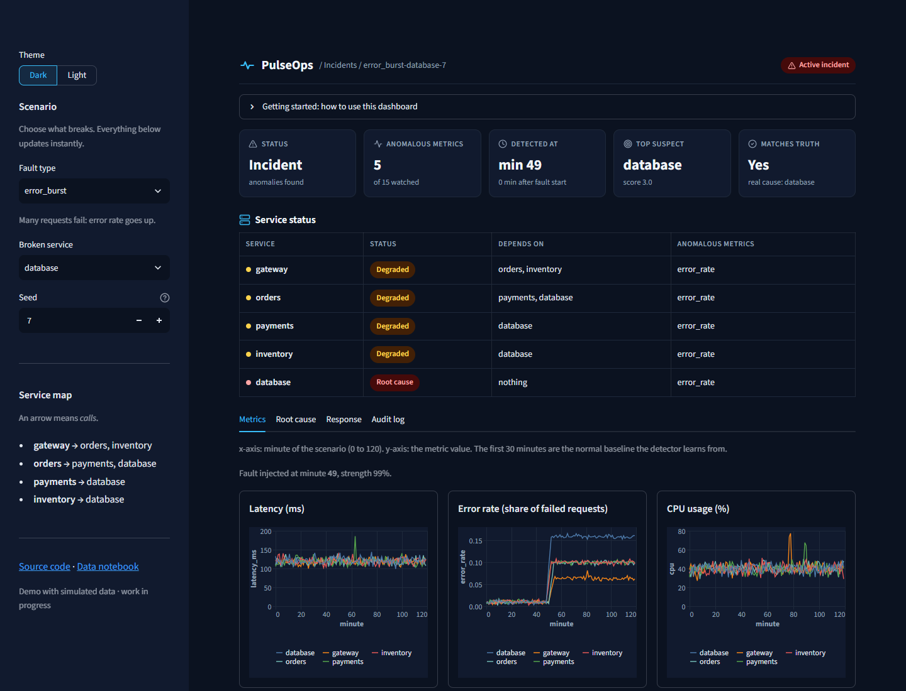
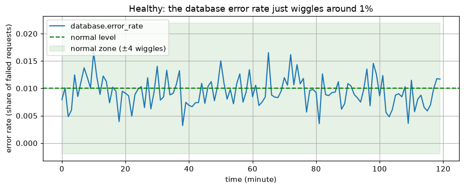
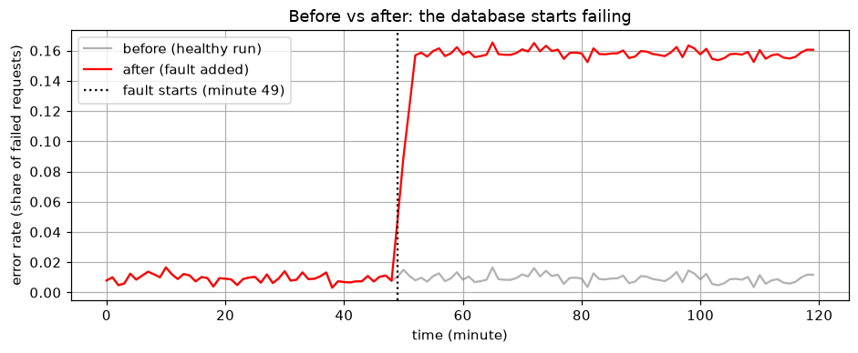
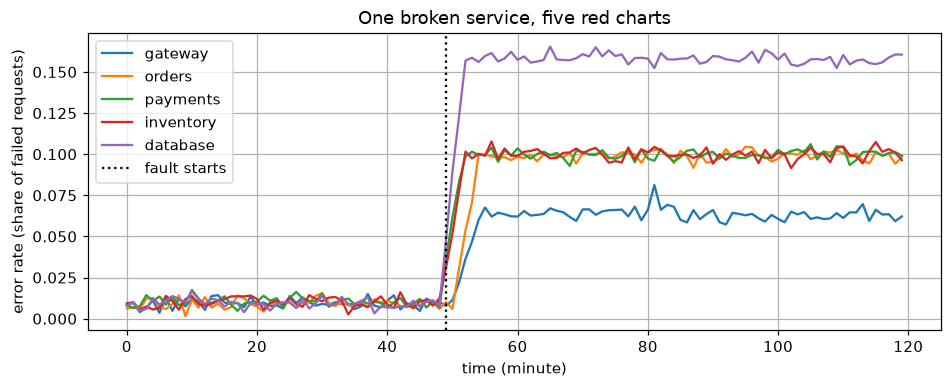
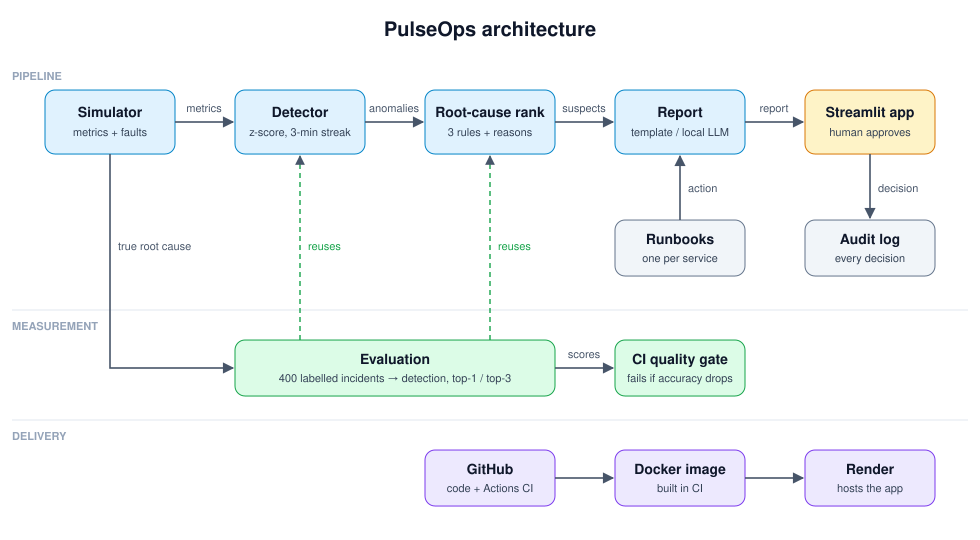

# PulseOps

**Finds which service broke, explains why, and asks a human before fixing anything.**



<sub>Dark theme shown. Switch to light in the sidebar ([screenshot](docs/figures/dashboard-light.png)). Open a scenario directly with a link like `?fault=error_burst&service=database&theme=light`.</sub>

> **Status: work in progress.** The core pipeline works and is measured. Live demo,
> demo video and real Prometheus data are still being added.

- **Live app:** https://pulseops-ecck.onrender.com (free plan: first load can take ~1 minute)

**Using the live app (1 minute):** pick a **Fault** and a **Broken service** in the
sidebar (try `error_burst` + `database`). Read the KPI cards and the service-health row,
check the **Root cause** tab for the reasons, then **Approve** or **Reject** the proposed
fix in the **Incident** tab. The "Truth" box shows the real answer, so you can check
PulseOps. A full guide is built into the app.
- **Demo video:** not recorded yet

## The problem

When something breaks in a system made of many services, the alerts go off everywhere
at once. The payments service fails, so orders fail, so the gateway fails, and the
on-call engineer gets three alerts that all look like "the problem". A lot of the
incident time goes into working out *which* service actually started it.

## The data

> Full walk-through, from zero: [notebooks/01_data.ipynb](notebooks/01_data.ipynb).
> Read that one notebook and the data part is fully covered.

**The system.** A small online shop made of 5 services. An arrow means "calls":

```
gateway ──> orders ──> payments ──> database
   └──────> inventory ─────────────> database
```

**What we measure.** Every minute, 3 numbers per service: `latency_ms` (how slow),
`error_rate` (share of failed requests) and `cpu` (how busy). So one scenario is a table
of **120 minutes × 15 columns** (`service.metric`, e.g. `database.error_rate`).

**Healthy.** Numbers wiggle around a normal level (x = minute, y = share of failed requests):



**Before vs after a fault.** The same metric, healthy (grey) and with the database
broken (red). It ramps up over a few minutes and *stays* up, unlike a short blip:



**The domino effect.** Everything that calls the database goes red too, a bit weaker
and a bit later. Five alarms, one real cause. That's the problem PulseOps solves:



**Where the data comes from.** In this version, a simulator
([`simulator.py`](src/pulseops/simulator.py)) generates it: a healthy table, then a
fault added on top (4 kinds: slow queries, error burst, CPU saturation, bad deploy)
with random strength. Because we inject the fault, we always know the true root cause,
so accuracy can be measured. In a real company the same table would come from
**Prometheus** (each service exposes metrics, Prometheus collects them every 15 s) and
deploy events from the CI/CD tool. That's the next phase, not built yet.

Sample files: [`data/`](data/) (`healthy.csv`, one CSV per fault kind, `labels.csv`
with the true answer for each). Rebuild them and the figures with:

```bash
uv sync --group notebook
uv run jupyter nbconvert --to notebook --execute --inplace notebooks/01_data.ipynb
```

## What PulseOps does

1. **Watches metrics** (latency, error rate, CPU) for 5 services.
2. **Spots anomalies** with a simple z-score check: a metric has to stay far from its
   normal level for 3 minutes in a row, so one-off blips are ignored.
3. **Ranks the likely root cause** with three rules anyone can check:
   - none of the services it calls look broken,
   - it went wrong first,
   - it was deployed just before the trouble started.
   Every point comes with a written reason.
4. **Proposes a fix** from that service's runbook.
5. **Waits for a human.** The engineer approves or rejects, and every decision is
   written to an audit log. Nothing runs on its own.

## Results

Measured on 400 simulated incidents (4 fault types × 5 services × 20 seeds) plus
100 healthy runs. Faults have random strength (10–100%), ramp up over 3–9 minutes,
and spread to the calling services with a 0–2 minute delay.

| Fault | Runs | Detected | Minutes to detect | Top-1 root cause | Top-3 root cause |
|---|---|---|---|---|---|
| slow_queries | 100 | 100% | 1.9 | 100% | 100% |
| error_burst | 100 | 100% | 0.6 | 100% | 100% |
| cpu_saturation | 100 | 93% | 3.5 | 93% | 93% |
| bad_deploy | 100 | 100% | 0.8 | 100% | 100% |
| all | 400 | 98% | 1.7 | 98% | 98% |

False alarms on 100 healthy runs: 0%

Reproduce with `uv run python -m pulseops.evaluate`.

**Read these numbers carefully.** They come from a simulator where faults spread
cleanly along a known service map, so the ranking rules have an easy job. The misses
are mild CPU faults that never rise above the noise. Real systems are messier
(retries, shared infrastructure, missing metrics), so expect lower accuracy there.
That's the main limitation, listed below.

## Architecture



| File | Job |
|---|---|
| `services.py` | the service map and normal metric levels |
| `simulator.py` | generates metrics and injects faults with a known root cause |
| `detector.py` | z-score anomaly detection |
| `rca.py` | ranks root-cause suspects, with reasons |
| `report.py` | writes the incident report and picks the runbook action |
| `audit.py` | logs approve / reject decisions |
| `evaluate.py` | runs hundreds of scenarios and measures accuracy |
| `app.py` | Streamlit UI |

Deployment: GitHub Actions runs lint, tests and the accuracy gate, then builds the
Docker image; Render builds the same Dockerfile ([`render.yaml`](render.yaml)) and hosts
the app.

More detail: [docs/architecture.md](docs/architecture.md) ·
design choices: [docs/decisions.md](docs/decisions.md)

## Quickstart

Needs Python 3.12 and [uv](https://docs.astral.sh/uv/).

```bash
git clone https://github.com/ubaidur404786/pulseops.git
cd pulseops
uv sync
uv run streamlit run src/pulseops/app.py
```

Or with Docker (the same image Render runs):

```bash
docker build -t pulseops .
docker run -p 8501:8501 pulseops
```

Then open http://localhost:8501, pick a fault and a service in the sidebar, and check
PulseOps's answer against the "Truth" box.

Run the tests and the evaluation:

```bash
uv run pytest
uv run python -m pulseops.evaluate
```

### Optional: LLM-written summary

The report is a plain template by default. If you have [Ollama](https://ollama.com)
running locally, set `OLLAMA_MODEL` (see `.env.example`) and a local model will rewrite
the report in friendlier words. It only gets the evidence PulseOps found; it doesn't
choose the root cause. *This path hasn't been tested yet.*

## How it works

**Why z-scores?** For each metric, the first 30 minutes give a normal mean and
standard deviation. A value more than 4 standard deviations away for 3 minutes
straight is an anomaly. It's easy to explain and needs no training.

**Why rules instead of an LLM for the root cause?** Rules give the same answer every
time, can be unit-tested, and every score has a reason the engineer can check. An LLM
picking the root cause would be hard to evaluate and could invent causes.

**Why a simulator?** To measure root-cause accuracy you need to know the true root
cause. The simulator gives hundreds of labelled incidents in seconds.

**Quality gate:** `tests/test_evaluate.py` runs a smaller evaluation in CI and fails
the build if detection or top-1 accuracy drops below the set thresholds.

## Known limitations

- **Simulated data only.** No real services or Prometheus yet. Faults spread cleanly
  along the service map, which makes ranking easier than in real life.
- One fault at a time. Two overlapping incidents aren't handled.
- The detector uses a fixed baseline. It can't handle daily traffic patterns.
- Runbooks are per service, not per fault type, so the proposed action is sometimes
  generic.
- Approving an action only logs it. Nothing is actually executed.
- The local-LLM summary is optional and untested.
- On Render's free plan the app sleeps when idle (first load takes ~1 minute) and the
  audit log resets on every redeploy.

## Contact

Questions about the design or the numbers? Reach me on [LinkedIn](https://www.linkedin.com/in/ubaid-ur-rehman-422212177/)
or open an issue.

## License

MIT
